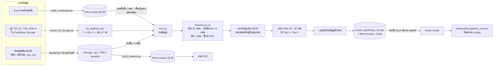
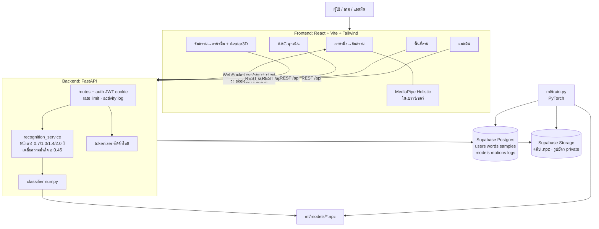

# SignBridge TH — สถานะโปรเจค, Data Pipeline และ Diagram

ข้อมูล ณ 7 ต.ค. 2569 (ตัวเลขความแม่นยำดึงจากตาราง `models` ใน database จริง)

## 1. ภาพรวม

ระบบสื่อสารสองทางระหว่างผู้ใช้ภาษามือไทย (TSL) กับผู้ไม่ใช้ภาษามือ

| ฟีเจอร์ | สถานะ |
|---|---|
| ภาษามือ → ข้อความ (กล้อง + MediaPipe + WebSocket + CNN) | ใช้งานได้ · โมเดล active v0.0.8 |
| ข้อความ → ภาษามือ (ตัดคำ + อวตาร 3D) | ใช้งานได้ · อวตารทำได้ 35 คำ |
| ปุ่มฉุกเฉิน AAC + พูดออกเสียง | ใช้งานได้ · ผู้ล็อกอินเพิ่มปุ่มเองได้ |
| พื้นที่ล่าม (อัด/อัปโหลดคลิป) | ใช้งานได้ |
| แอดมิน (แดชบอร์ด ผู้ใช้ คลังคำ โมเดล ชุดทดสอบ log) | ใช้งานได้ |
| ล็อกอิน อีเมล / Google / LINE + โปรไฟล์ + รูปบัตรคนพิการ | ใช้งานได้ |
| โหมดสว่าง/มืด | ใช้งานได้ |

ตัวเลขข้อมูล: คลังคำ 262 คำ · ติ๊กเทรน 25 คำ (24 คำ + คลาส "ไม่ทำท่า") · คลิปเทรนรวม 778 คลิป (TSL เป็นหลัก, คลิปล่ามที่อัดเองมี 9 คลิป) · ผู้ใช้ 4 คน

## 2. ความแม่นยำของโมเดล

วัดบน **ผู้แสดงที่ไม่อยู่ในชุดเทรน** (6 คน, 246 คลิป) — เข้มกว่าการสุ่มแบ่งคลิป

| เวอร์ชัน | คลิป | Top-1 | Top-3 | สถานะ |
|---|---|---|---|---|
| v0.0.3 | 778 | 72.4% | 92.7% | archived |
| v0.0.5 | 773 | 70.7% | 94.3% | archived |
| v0.0.6 | 778 | 67.5% | 94.7% | archived |
| v0.0.7 | 778 | **74.0%** | **95.1%** | archived |
| **v0.0.8** | 778 | **72.0%** | **91.5%** | **active** |

(v0.0.0–0.0.2 เป็นการทดสอบระบบด้วย 5 คลิป ไม่มีค่าวัดผล)

สรุป: Top-1 ≈ **72%**, Top-3 ≈ **92%** ผลแกว่ง ±3% ระหว่างรอบเทรน (ชุดทดสอบเล็ก 246 คลิป) โมเดล CNN 1 มิติ 3 ชั้น ขนาด ~1.2 MB รันด้วย numpy ล้วนฝั่ง backend

คำที่ทายพลาดบ่อย (จาก log v0.0.4): กลัว, ที่ไหน, โรงเรียน 0% · ทำไม 10% · ไม่ทำท่า 39%

**ข้อควรระวังเรื่อง "ความสำเร็จ"**
- ตัวเลขข้างบนวัดบนชุดข้อมูล TSL (คลิปในห้องอัด) ยังไม่ได้วัดกับกล้องเว็บแคมจริงของผู้ใช้ → ตอนใช้งานจริงน่าจะต่ำกว่า
- v0.0.8 ที่ active ไม่ใช่ตัวที่ดีที่สุด (v0.0.7 ดีกว่าเล็กน้อย) แต่ส่วนต่างอยู่ในช่วงความแกว่งปกติ
- รองรับแค่ 24 คำจาก 262 คำในคลัง — ยังไม่พอใช้สนทนาจริง

## 3. Data Pipeline

## 4. Architecture ของระบบ

## 5. สิ่งที่ยังต้องทำ

**โมเดล / ข้อมูล (สำคัญที่สุด)**
1. เพิ่มจำนวนคำที่เทรน (ตอนนี้ 24 จาก 262) — ล่ามต้องอัดคลิปเพิ่ม (เกณฑ์ ≥ 5 คลิป/คำ, ควรได้ 30+)
2. คำที่พลาดบ่อย (กลัว, ที่ไหน, โรงเรียน, ทำไม) ต้องเก็บคลิปเพิ่ม/ดูว่าท่าคล้ายคำอื่นหรือไม่
3. วัดความแม่นยำกับเว็บแคมจริงของผู้ใช้ (ตอนนี้วัดแค่บนชุดทดสอบ TSL) และเก็บ confusion matrix
4. ปรับคลาส "ไม่ทำท่า" (39%) เพื่อลดคำเด้งมั่วตอนไม่ได้ทำท่า
5. ทำให้ผลแกว่งน้อยลง: เทรนหลาย seed / cross-validation ตามผู้แสดง

**วิศวกรรม**
6. ยังไม่มีเทสอัตโนมัติ (`backend/tests/` ว่าง) และ `docs/` เพิ่งเริ่มมีไฟล์นี้
7. commit schema SQL ให้ครบ (`backend/sql/` มีแค่ 002, 003 — ไม่มี 001) เพื่อสร้าง database ใหม่ได้
8. ไฟล์โมเดล `.npz` ไม่อยู่ใน git (ถูก ignore) — ต้องมีที่เก็บกลาง/ขั้นตอนแจกจ่ายให้ทีม
9. ลบไฟล์ว่างที่ไม่ได้ใช้ (`evaluate.py`, `extract_landmarks.py`, `split.py`, `train_baseline.py`, `core/logging.py`, `ml/preprocessing.py`) และ `.h5` ปลอม 18 byte ใน `ml/models/`
10. เตรียม deploy จริง (HTTPS, `COOKIE_SECURE`, CORS, Docker production)
